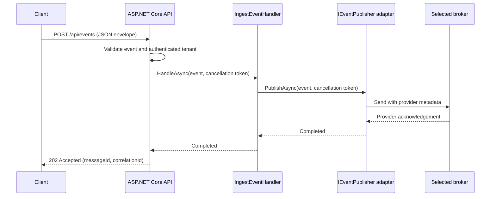

# Event Ingestion Service

A .NET 10 ASP.NET Core API that accepts JSON event envelopes and publishes them through a broker-independent application boundary. The current Infrastructure adapters are Azure Service Bus and RabbitMQ; provider selection is configuration-driven.

## Architecture

```text
HTTP client
	|
	v
EventIngestion.Api  --->  EventIngestion.Application  --->  IEventPublisher
								  |                              ^
								  v                              |
						   EventIngestion.Domain        EventIngestion.Infrastructure
															  |             |
															  v             v
													  Azure Service Bus   RabbitMQ
```

Dependency rules:

- **Domain** has no project dependencies. It owns the `EventEnvelope` contract.
- **Application** depends on Domain and defines `IEventPublisher` and `IngestEventHandler`. It has no broker SDK references.
- **Infrastructure** depends on Application and Domain and contains provider-specific adapters and registration.
- **API** is the composition root and depends on Application and Infrastructure.

```text
src/
  EventIngestion.Api/             ASP.NET Core API and composition root
  EventIngestion.Application/     Ingestion handler and publisher port
  EventIngestion.Domain/          Event contract
  EventIngestion.Infrastructure/  Azure Service Bus and RabbitMQ adapters
 tests/
  EventIngestion.UnitTests/       Handler, adapter configuration, DI, and telemetry tests
  EventIngestion.IntegrationTests/ API tests and opt-in broker tests
scripts/
  LoadTest.ps1                    Bounded HTTP load test
```

### Ingestion flow



## Requirements

- .NET 10 SDK
- Docker Desktop / Docker Engine with Docker Compose (for local RabbitMQ)
- Azure namespace and data-plane sender permissions only when using Azure Service Bus

## Build and test

From the repository root:

```powershell
dotnet restore EventIngestion.sln
dotnet build EventIngestion.sln
dotnet test EventIngestion.sln
```

NuGet package versions are centrally managed in `Directory.Packages.props`. Add or update a `PackageVersion` there, and add versionless `PackageReference` entries to the projects that use the package.

The default test run does not require either broker. Broker-adapter integration tests are opt-in through environment variables; skipped tests are reported by xUnit when configuration is absent.

## Run the API and RabbitMQ in containers

With Docker Desktop or Docker Engine running, from the repository root:

```powershell
docker compose up --build -d
docker compose ps
Invoke-RestMethod 'http://localhost:8080/health/live'
Invoke-RestMethod 'http://localhost:8080/health/ready'
```

Compose builds `event-ingestion-api:local` using the root Dockerfile and starts it after RabbitMQ reports healthy. The API connects to the `rabbitmq` service over the Compose network; port 8080, AMQP, and the RabbitMQ management UI are exposed on loopback only. The multi-stage image uses .NET 10 SDK and ASP.NET Core runtime images and runs the API as a non-root user. HTTP and the default credentials are for local development only; production deployments need TLS and securely supplied credentials.

The readiness check verifies broker connectivity; it does not publish an event. To exercise publishing against the local broker, run the opt-in RabbitMQ adapter integration test described below. An unauthenticated `POST http://localhost:8080/api/events` returns `401`. To accept authenticated ingestion requests, configure the Entra settings described below; do not use a test-only authentication bypass in production.

To check the unauthenticated response in PowerShell 7:

```powershell
$body = @{ eventName = 'DeviceRegistered'; tenantId = 'tenant-123'; payload = @{ deviceId = 'test' } } | ConvertTo-Json
$response = Invoke-WebRequest 'http://localhost:8080/api/events' -Method Post -ContentType 'application/json' -Body $body -SkipHttpErrorCheck
$response.StatusCode # 401
```

View logs and stop the containers with:

```powershell
docker compose logs api rabbitmq
docker compose down
```

The named RabbitMQ volume survives `down`. RabbitMQ initializes its default user only on a fresh data volume; changing `RABBITMQ_DEFAULT_USER` or `RABBITMQ_DEFAULT_PASS` later does not update an existing user. Manage users in RabbitMQ or, if the data can be discarded, recreate the volume deliberately with `docker compose down -v` and start again.

## Local RabbitMQ without the API container

Start RabbitMQ with the management plugin:

```powershell
docker compose up -d rabbitmq
docker compose ps
```

The Compose service binds to loopback only:

- AMQP: `localhost:5672`
- Management UI: <http://localhost:15672>
- Local Compose default login: `eventing` / `local-development-only`

These defaults are for local development only. Override them with `RABBITMQ_DEFAULT_USER` and `RABBITMQ_DEFAULT_PASS` before starting Compose if needed. The named volume preserves broker data. Stop the service with `docker compose down`; add `-v` only when intentionally deleting local broker data.

In the same PowerShell session used to launch the API, configure matching credentials:

```powershell
$env:Messaging__Provider = 'RabbitMQ'
$env:Messaging__RabbitMQ__HostName = 'localhost'
$env:Messaging__RabbitMQ__Port = '5672'
$env:Messaging__RabbitMQ__UserName = 'eventing'
$env:Messaging__RabbitMQ__Password = 'local-development-only'
$env:Messaging__RabbitMQ__VirtualHost = '/'
$env:Messaging__RabbitMQ__ExchangeName = 'events'
$env:Messaging__RabbitMQ__ExchangeType = 'topic'
$env:Messaging__RabbitMQ__RoutingKey = 'events.ingested'
$env:Messaging__RabbitMQ__UseTls = 'false'
dotnet run --project src\EventIngestion.Api\EventIngestion.Api.csproj
```

The .NET environment-variable provider maps `__` to `:`. The base appsettings enables TLS; `appsettings.Development.json` disables it for the local Compose broker. Local credentials must not be reused in production.

## Azure Service Bus

Create an Azure Service Bus namespace and a topic or queue (default entity type is `Topic`). Grant the workload identity the **Azure Service Bus Data Sender** role on the narrowest appropriate scope. On Azure-hosted workloads, prefer managed identity; locally, configure an appropriate `DefaultAzureCredential` developer login. Avoid putting shared access keys in source-controlled settings. If a connection string is unavoidable for development, supply it as a secret environment variable or through a secret store.

Managed identity / `DefaultAzureCredential` configuration:

```powershell
$env:Messaging__Provider = 'AzureServiceBus'
$env:Messaging__AzureServiceBus__FullyQualifiedNamespace = 'your-namespace.servicebus.windows.net'
$env:Messaging__AzureServiceBus__EntityName = 'events'
$env:Messaging__AzureServiceBus__EntityType = 'Topic' # or Queue
dotnet run --project src\EventIngestion.Api\EventIngestion.Api.csproj
```

Optional secret-based local connection string configuration (do not commit it):

```powershell
$env:Messaging__Provider = 'AzureServiceBus'
$env:Messaging__AzureServiceBus__ConnectionString = $env:EVENTING_AZURE_SERVICEBUS_CONNECTION_STRING
$env:Messaging__AzureServiceBus__EntityName = 'events'
$env:Messaging__AzureServiceBus__EntityType = 'Topic'
```

Configure exactly one of `ConnectionString` or `FullyQualifiedNamespace`. Startup validates only the selected provider, so the inactive broker does not need credentials or settings.

## API

The endpoint is `POST /api/events`. Example envelope:

```json
{
  "eventName": "DeviceRegistered",
  "tenantId": "tenant-123",
  "correlationId": "request-456",
  "payload": {
	"deviceId": "device-42",
	"registered": true
  }
}
```

`messageId` and `occurredAtUtc` are generated when omitted. Tenant identity is taken from the authenticated `tenant_id` claim; an absent or conflicting request tenant is rejected. Do not put bearer tokens or other credentials in event payloads.

On completion of the selected adapter's send operation, the API returns `202 Accepted` with a receipt:

```json
{
  "messageId": "generated-or-supplied-id",
  "correlationId": "request-456"
}
```

### Single-tenant Microsoft Entra authentication

Set `Entra__TenantId` to the directory ID and `Entra__ClientId` to the API app registration's client ID. Both must be GUIDs; supplying only one prevents startup. Without either setting, no production authentication scheme is enabled and ingestion fails closed. Configure the API registration to issue v2 access tokens, expose the delegated scope `Event.Ingest` and/or an application role named `Event.Ingest`, and grant the chosen permission to authorized client applications. For application roles, configure the API registration's optional **access token** claim `idtyp`; the API requires `idtyp=app`. Admin consent may be required.

The API validates the token signature, v2 issuer, audience, lifetime, tenant (`tid`), and either the `Event.Ingest` delegated scope or the role on an app-only access token. It derives its trusted `tenant_id` from the validated Entra directory ID, ignoring any token-supplied `tenant_id`. Thus this deployment uses **one Entra directory as its event tenant**, not a separate tenant per customer. A caller-supplied envelope tenant, if present, must equal that directory ID. Test-only authentication handlers are never registered by the production application.

## Health, tracing, and metrics

- `GET /health/live` reports API process liveness and does not probe the broker.
- `GET /health/ready` includes the selected broker health check, with a five-second timeout.
- OpenTelemetry captures ASP.NET Core traces and runtime metrics. The messaging instrumentation emits a producer span, `eventing.publish.successes`, `eventing.publish.failures`, and `eventing.publish.duration`.
- Set `OTEL_EXPORTER_OTLP_ENDPOINT` to enable OTLP export. Without it, the application runs without an OTLP exporter.

The readiness probe creates/checks provider resources without sending an event. Health endpoints should be restricted or handled according to the hosting environment's network and information-disclosure policy.

## Azure test deployment

Terraform in `infrastructure/terraform` provisions a resource group, Basic ACR, a one-node AKS cluster on the Free control-plane tier, Standard Service Bus with an `events` topic and `test` subscription, Key Vault, Log Analytics, a subscription budget, and scoped managed-identity role assignments. The AKS kubelet can pull images; the application workload identity can send to the topic and read Key Vault secrets. Local Service Bus key authentication and AKS local admin accounts are disabled. The AKS Secrets Store CSI add-on is enabled; `k8s/secret-provider-class.yaml` is an optional template, not mounted or deployed until a real secret is needed.

**This is not free or production-ready.** Service Bus Standard has a base charge. Nodes, disks (including the TLS certificate volume), ACR, public IP/load balancing, logs, state storage and other resources can incur charges even with little traffic. Estimate costs for the selected subscription and region first. The subscription-wide budget includes the AKS-managed resource group but is an alert, not a spending limit. Key Vault purge protection means its name remains unavailable during the retention period even after deletion. Stopping AKS does not stop all other charges.

### Prerequisites and bootstrap

1. Use a dedicated test subscription and verify region, resource provider registrations, AKS VM quota, and pricing. Push this repository to Azure Repos and create an Azure DevOps project.
2. Before running Terraform, separately create a private Azure Storage account and blob container for state, ideally in a separate resource group. Disable shared-key access, use Entra authentication, and grant the infrastructure pipeline identity **Storage Blob Data Contributor** on the container. Restrict state, plan artifacts and pipeline access: plans and state can contain sensitive values. The bootstrap storage is not managed or deleted by this Terraform configuration.
3. Create two Azure Resource Manager service connections using workload identity federation. Give the infrastructure identity subscription permissions sufficient to create resources, budgets, and role assignments (Contributor alone cannot create role assignments), plus state-container access. Record the **object ID** of the separate application service principal. Terraform grants that principal `AcrPush` and `Reader` on ACR, plus AKS Cluster User and AKS RBAC Cluster Admin on this test cluster. Cluster Admin is required here for automated namespace creation and is broad; restrict the service connection and move to namespace-scoped deployment permissions after bootstrapping for stronger isolation.
4. Register a **single-tenant** Entra API application. In its manifest set `requestedAccessTokenVersion` to `2`. Under Expose an API set an application ID URI such as `api://<api-client-id>` and create delegated scope `Event.Ingest`; optionally create the `Event.Ingest` app role for application clients. To use the app role, add `idtyp` as an optional **access token** claim on the API registration. Register a separate client, grant the API permission and consent it. For app-only testing, assign the application role and use an appropriate client credential or federation; for delegated testing, request the delegated scope. A token for Microsoft Graph or an ID token is not an API access token. Keep client credentials out of Terraform, manifests and source control.
5. Create both YAML pipelines. Restrict who may edit pipelines, queue runs, access service connections and approve infrastructure changes; protect the deployment branch and service connections with Azure DevOps checks. The repository YAML approval alone is not a security boundary against someone who can modify the pipeline. Configure the infrastructure approver to your own authorized account.

### Infrastructure pipeline

`pipelines/infrastructure.yml` is manually triggered. It always formats/checks, initializes, validates and produces a saved plan. The default `apply` parameter is false. To apply, start a run with `apply` enabled, review that run's `tfplan/plan.txt` and cost, and explicitly approve its manual validation. Only that saved plan is applied; a changed state can invalidate it. Rerun the plan when infrastructure changes or drift must be examined. Terraform itself never applies automatically as part of application deployment.

Set these Azure DevOps pipeline variables before running:

| Variable | Value |
| --- | --- |
| `INFRA_SERVICE_CONNECTION` | Name of the federated infrastructure service connection |
| `LOCATION`, `NAME_PREFIX` | Azure region such as `eastus`; globally unique lowercase alphanumeric prefix of 3-12 characters |
| `DEPLOYMENT_PRINCIPAL_ID` | Object ID of the application service connection's service principal, not its client ID |
| `STATE_RESOURCE_GROUP`, `STATE_STORAGE_ACCOUNT`, `STATE_CONTAINER`, `STATE_KEY` | Existing state backend resource group, account, private container and unique state blob name |
| `BUDGET_AMOUNT`, `BUDGET_START_DATE`, `BUDGET_ALERT_EMAIL` | Monthly amount in subscription billing currency, stable first day of a month such as `2026-11-01T00:00:00Z`, and alert recipient |
| `TF_APPROVERS` | Azure DevOps user or group authorized to approve applies |

The pipeline publishes `infrastructure-outputs/outputs.json` after an approved apply. Copy its non-secret values to the application pipeline variables below. Keep the Terraform state and lock file; do not delete the state backend while resources are managed by it.

### Application pipeline and public endpoint

`pipelines/application.yml` builds and tests the solution and the manifest renderer, builds and smoke-tests the image locally on the agent, pushes a build-tagged image to ACR, and deploys to AKS. It never runs Terraform. Configure its variables and enable it only after infrastructure has been applied:

| Variable | Value |
| --- | --- |
| `APP_SERVICE_CONNECTION` | Name of the separate application deployment service connection |
| `RESOURCE_GROUP`, `AKS_NAME`, `ACR_NAME` | Terraform outputs `resource_group_name`, `cluster_name`, `registry_name` |
| `K8S_NAMESPACE`, `SERVICE_ACCOUNT` | Terraform outputs `kubernetes_namespace`, `service_account_name`; must match the federated identity |
| `WORKLOAD_IDENTITY_CLIENT_ID` | Terraform output `workload_identity_client_id` |
| `SERVICE_BUS_NAMESPACE`, `SERVICE_BUS_TOPIC` | Terraform outputs `service_bus_namespace`, `service_bus_topic` |
| `ENTRA_TENANT_ID` | Terraform output `tenant_id` |
| `ENTRA_API_CLIENT_ID` | Client ID of the Entra **API** registration, not the workload identity |
| `DNS_LABEL`, `PUBLIC_HOST` | Unique Azure public-IP DNS label and its expected FQDN, e.g. `eventtest` and `eventtest.eastus.cloudapp.azure.com`; verify the region's DNS suffix |
| `ACME_EMAIL` | Contact email for the public TLS certificate issuer |

The LoadBalancer service creates a public IP with the DNS label. A single pinned Caddy sidecar obtains and renews a public certificate over ports 80/443 and terminates HTTPS; its certificate data is stored on a persistent Azure disk. The API listens on port 8080 inside the pod. HTTPS redirection is disabled **only behind this TLS proxy**; do not expose the API's port directly. Public health endpoints are intentional for test verification. This minimal setup has no WAF or rate limiting, one replica and potential downtime during updates; do not treat it as a production ingress architecture. First-time DNS, role propagation and certificate issuance can take time; the deployment checks rollout and the public HTTPS liveness endpoint.

Use a client-issued Entra v2 access token for this API with the `Event.Ingest` delegated scope or app role. Send it as a bearer token to `https://<PUBLIC_HOST>/api/events`; omit `tenantId` or supply the configured Entra tenant ID. A successful response is `202` only after broker publication. The test subscription allows a separately authorized receiver to verify the event; no receiver is deployed by this project. Grant the receiver `Azure Service Bus Data Receiver` separately.

The Log Analytics agent collects cluster logs, but this alone does not export the application's OpenTelemetry traces and metrics. Configure an OTLP collector and `OTEL_EXPORTER_OTLP_ENDPOINT` separately if needed.

To use a Key Vault secret later, first create the secret through an appropriately authorized secure workflow. Set `K8S_NAMESPACE`, `ENTRA_TENANT_ID`, `WORKLOAD_IDENTITY_CLIENT_ID`, `KEY_VAULT_NAME`, and `KEY_VAULT_SECRET_NAME`, then run `python scripts/RenderKubernetes.py --secret-provider-class` and apply the rendered manifest. Add a CSI volume referencing that SecretProviderClass to the workload before expecting the secret file to be mounted. No secret is needed for Service Bus authentication.

After testing, review any Terraform destroy plan and obtain approval before removing resources. Removing the application service and persistent volume may also require deliberate Kubernetes cleanup. Preserve the state backend until managed resources are removed, then separately review cleanup of the bootstrap storage, subscriptions and app registrations.

## Broker adapter integration tests (opt-in)

### RabbitMQ

Use the Compose service, or provide another disposable RabbitMQ instance. The test creates a uniquely named exchange, routing key, and exclusive queue, publishes a message, then verifies the received envelope, metadata, persistence flag, and routing. Set these variables in the same shell used for `dotnet test`:

```powershell
$env:EVENTING_RABBITMQ_HOST = 'localhost'
$env:EVENTING_RABBITMQ_PORT = '5672'
$env:EVENTING_RABBITMQ_USERNAME = 'eventing'
$env:EVENTING_RABBITMQ_PASSWORD = 'local-development-only'
$env:EVENTING_RABBITMQ_VIRTUAL_HOST = '/'
$env:EVENTING_RABBITMQ_USE_TLS = 'false'
dotnet test tests\EventIngestion.IntegrationTests\EventIngestion.IntegrationTests.csproj --filter FullyQualifiedName~RabbitMqEventPublisherIntegrationTests
```

### Azure Service Bus

Set either a connection string or namespace. For the namespace option, `DefaultAzureCredential` must be able to authenticate and have sender access. The named entity must already exist. The test verifies the provider send completes successfully; it does not consume from the entity.

Use one of these authentication options, not both:

```powershell
# Option A: connection string supplied by your secret manager
$env:EVENTING_AZURE_SERVICEBUS_CONNECTION_STRING = $env:YOUR_SECRET_VARIABLE
Remove-Item Env:EVENTING_AZURE_SERVICEBUS_NAMESPACE -ErrorAction SilentlyContinue
```

```powershell
# Option B: managed identity / DefaultAzureCredential
$env:EVENTING_AZURE_SERVICEBUS_NAMESPACE = 'your-namespace.servicebus.windows.net'
Remove-Item Env:EVENTING_AZURE_SERVICEBUS_CONNECTION_STRING -ErrorAction SilentlyContinue
```

Then set the entity and run the test:

```powershell
$env:EVENTING_AZURE_SERVICEBUS_ENTITY_NAME = 'events'
$env:EVENTING_AZURE_SERVICEBUS_ENTITY_TYPE = 'Topic' # or Queue
dotnet test tests\EventIngestion.IntegrationTests\EventIngestion.IntegrationTests.csproj --filter FullyQualifiedName~AzureServiceBusEventPublisherIntegrationTests
```

Do not run integration tests against production entities. The RabbitMQ test publishes a uniquely identified event; the Azure test sends a uniquely identified event into the configured entity.

## HTTP load test

The script exercises the HTTP API, not the broker. For example:

```powershell
.\scripts\LoadTest.ps1 `
	-Endpoint 'https://localhost:7001/api/events' `
	-Count 1000 `
	-Concurrency 20 `
	-BatchSize 50 `
	-EventName 'DeviceRegistered' `
	-TenantId 'tenant-123' `
	-BearerToken '<token>' `
	-WarmupCount 20 `
	-TimeoutSeconds 30 `
	-PayloadJson '{"deviceId":"load-test"}'
```

Use a valid token accepted by the authentication scheme configured in your deployment. For local HTTPS development, trust the ASP.NET Core development certificate or use the API's HTTP URL.

`Concurrency` bounds simultaneous requests. `BatchSize` bounds each request group before progress is reported. Warm-up requests run separately and are excluded from measured statistics. The script reports total measured wall-clock time, successful HTTP status responses, status-code counts, throughput (`measured request count / measured elapsed seconds`), and average/P95/P99 request latency. A publish-confirmed result requires the API's `202 Accepted` response and a receipt whose `messageId` and `correlationId` match that request. Other 2xx responses count as HTTP successes but do not confirm publishing. Any HTTP failure or unconfirmed publish makes the script exit nonzero.

## Reliability and delivery considerations

- **Azure Service Bus:** the SDK retries transient send failures with exponential backoff; the send task completes when the service accepts the send. A timeout after broker acceptance can leave the caller uncertain, and retrying an event can create duplicates. Configure broker-side duplicate detection if appropriate, but this sample does not implement application idempotency.
- **RabbitMQ:** the adapter declares a durable exchange, publishes persistent messages, enables publisher-confirm tracking, and uses mandatory publishing. A successful publish task represents broker publisher confirmation/routing according to RabbitMQ.Client's confirm behavior; it does not prove a consumer processed the message. Durability also depends on queue type, broker persistence, and cluster configuration. A connection loss around confirmation can make the outcome ambiguous and lead to duplicates on retry.
- Neither provider nor the API promises exactly-once delivery. Consumers should be idempotent and use `MessageId` where useful. Application-level idempotency and an outbox are future enhancements.
- Provider acknowledgement is not equivalent to downstream business processing. `202` means the selected publish operation completed according to the adapter's broker acknowledgement semantics.

## Current limitations and future enhancements

- Entra authentication is single-tenant and requires a separately configured API registration and authorized clients.
- The Azure deployment below is a single-node, single-replica test environment, not a production availability design.
- No application idempotency store, outbox, consumer, or dead-letter processing is included.
- Kafka and Azure Event Grid are future extension points and have no placeholder implementations.
- Broker integration tests require isolated broker resources and are skipped unless their environment configuration is present.
- Future work may include richer broker readiness checks, idempotency/outbox support, and optional sustained-load profiles.
